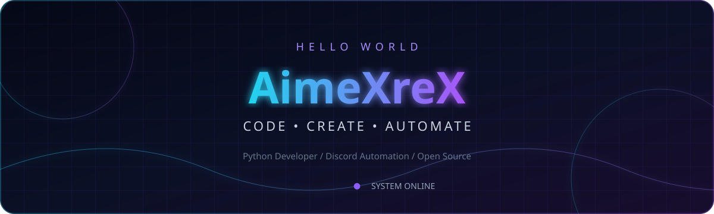
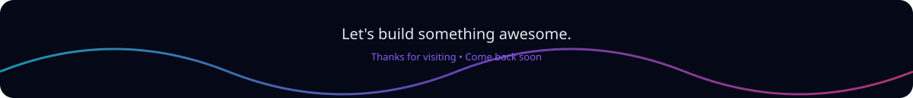

<div align="center">



<br/>

<a href="https://git.io/typing-svg"></a>

<p>
  <a href="https://twitter.com/AimeXre"></a>
  
  <a href="https://github.com/AimeXreX?tab=followers"></a>
</p>

</div>

## `> whoami`

```python
class AimeXreX:
    focus = ["Python", "Discord Bots", "Automation"]
    mindset = "Learn. Build. Improve. Repeat."
    currently = "Turning curiosity into code"

    def say_hi(self):
        return "Thanks for dropping by — let's build something cool!"
```

## `> toolbox --show`

<div align="center">
  
</div>

## `> featured_project`

<div align="center">
  <a href="https://github.com/AimeXreX/Red-DiscordBot">
    
  </a>
</div>

## `> github.telemetry`

<div align="center">
  
  
</div>

<br/>

<div align="center">
  
</div>

<div align="center">
  
</div>

<br/>



---

## `> whoami --lang=fa`

```python
class AimeXreX:
    تخصص = ["Python", "ربات‌های دیسکورد", "اتوماسیون"]
    رویکرد = "یاد بگیر. بساز. بهبود بده. تکرار کن."
    اکنون = "تبدیل کنجکاوی به کد"

    def سلام(self):
        return "خوش آمدید! بیایید چیز جالبی بسازیم."
```

توسعه‌دهنده پایتون با تمرکز بر ربات‌ها و اتوماسیون؛ پروژه‌های منتخب و آمار گیت‌هاب در همین صفحه (بالاتر) قابل مشاهده است.
